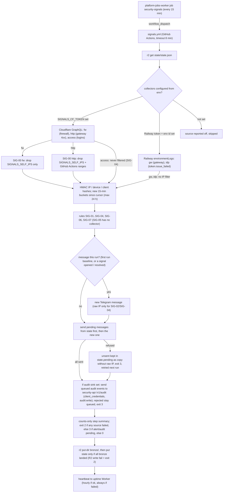
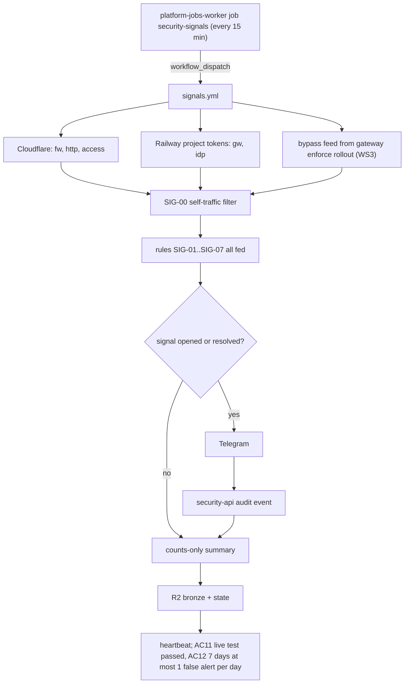

# 01 — Business process (As-Is / To-Be)

platform-security-signals คือ job ตรวจจับการโจมตีบน edge, gateway และ identity: ทุก 15 นาทีดึงตัวเลขจาก Cloudflare และ Railway logs เก็บใน R2 ประเมินกฎ SIG-00…SIG-07 แล้วส่ง Telegram ให้ owner เฉพาะตอน signal เปิดหรือปิด พร้อม audit event ไป `security-api`

Last reviewed: 2026-11-28 · commit `275cb2f`

## As-Is (จากโค้ดวันนี้)

Sources: `.github/workflows/signals.yml`, `security_signals/run.py` (`run`, `collectors_from_env`, `self_ips`), `security_signals/model.py` (`SelfTraffic`), `security_signals/report.py` (`message`), `security_signals/sources.py` (`Cloudflare`, `Railway`), `security_signals/rules.py`, `security_signals/engine.py`, `security_signals/audit.py`, `security_signals/r2.py`, `README.md` §Status

ข้อเท็จจริงจากโค้ด:

- `collectors_from_env` ไม่มี collector ของ `bypass` (SIG-05) ใน v1 (`# 'bypass' has no collector in v1 (fed by WS3 later)`) กฎ `_sig05` มีแล้วแต่ไม่มีข้อมูลเข้า
- `gw` และ `idp` รันเฉพาะเมื่อมี Railway token และ environment id; README §Status บอกว่ายังรอ project tokens จาก owner ว่า production ใช้ account token แทนอยู่หรือไม่ [ต้องยืนยัน]
- state เก็บเป็นไฟล์เดียว `state/state.json` (ตาม `signals.yml`) ไม่ใช่สามไฟล์ตาม §Storage layout ของ spec
- exit code: `0` ok, `2` source หรือ R2 ล้ม, `3` Telegram หรือ security-api ปฏิเสธ, `4` config ขาด; ถ้า source ล้มพร้อมกับ Telegram/audit ล้มในรอบเดียวกัน ได้ `2` (ลำดับใน `run()`) แต่รายการที่ส่งไม่ได้ยังค้างใน state และ workflow เปลี่ยนเป็น `2` เมื่อเขียน R2 ล้ม (`signals.yml`)
- SIG-00 ใช้ allowlist ต่างกันตาม source (`SelfTraffic.for_source`): `fw` ใช้แค่ `SIGNALS_SELF_IPS`, `http` ใช้ `SIGNALS_SELF_IPS` รวมช่วง GitHub Actions, `access` / `gw` / `idp` ไม่กรอง
- รอบแรก (ยังไม่มี state) ส่งข้อความ baseline เสมอ; ข้อความที่ค้างใน `state.pending` ถูกส่งซ้ำทุกรอบแม้ไม่มี signal เปลี่ยน และสำเนาที่เก็บไว้สร้างด้วย `show_ip=False` จึงไม่มี raw IP
- คิว audit ถูกส่งทุกรอบที่มี audit sink ไม่ว่า Telegram จะสำเร็จหรือไม่ (`AuditSink` มีเมื่อมี `SIGNALS_IDENTITY_PRIVATE_KEY_PEM` และไม่ใช่ `--no-notify`)

## To-Be (`docs/specs/001-security-signals.md`, approved 2026-11-28)

Sources: `docs/specs/001-security-signals.md` (§Sources, §Rules, R1, R10, R11, §Acceptance criteria, §Open items)

## Gap

| ID | As-Is → To-Be | Status | Owner | Evidence |
|---|---|---|---|---|
| G1 | SIG-05 (gateway bypass) มีกฎแต่ไม่มี collector → ป้อนข้อมูลจาก gateway enforce rollout (WS3) | blocked | claude | `security_signals/run.py` `collectors_from_env`; `README.md` §Rules SIG-05 "not wired yet" |
| G2 | source `gw` และ `idp` ยังไม่มี Railway project tokens → project tokens ต่อ project (R1, O-7) | blocked | owner | `README.md` §Status "Open"; spec §Open items O-7 |
| G3 | ยังไม่ได้ทำ live test แบบควบคุม → AC11 ผ่าน (SIG-02 เข้า Telegram ภายใน 30 นาที, SIG-03 เปิด แล้วทั้งคู่ปิดเอง) | todo | owner | spec AC11; `README.md` §Status |
| G4 | ยังไม่มีหลักฐาน 7 วันเงียบ → AC12: heartbeat ok 7 วัน, false alert ไม่เกิน 1 ต่อวัน | doing | claude | spec AC12, §First live day (2026-11-13) |
| G5 | D-2 owner ตัดสิน 2026-11-28: เก็บ hash อย่างเดียว ไม่เก็บ raw IP; variable `SIGNALS_KEEP_RAW_IP` ไม่ได้ตั้งใน repo (ตรวจ 2026-11-28) จึงเป็นค่าเริ่มต้นที่ปิดอยู่แล้ว | done | owner | spec §Open items D-2; `README.md` §Configuration |
| G6 | spec ยังเป็น `draft-for-review` → owner อนุมัติ spec; owner ตัดสิน 2026-11-28: อนุมัติ spec (D-2 = hash อย่างเดียว); front matter เป็น `approved` แล้ว | done | owner | `docs/specs/001-security-signals.md` front matter |
| G7 | spec §Storage layout บอก `cursors.json`, `signals.json`, `baselines.json` แต่โค้ดใช้ `state/state.json` ไฟล์เดียว → spec ตรงกับโค้ด | todo | claude | `.github/workflows/signals.yml`; spec §Storage layout |
| G8 | To-Be ส่งทุกแหล่งผ่าน SIG-00 แต่ spec หลังรีวิวแยกขอบเขต: `fw` ใช้ `SIGNALS_SELF_IPS` เท่านั้น ช่วง IP ของ GitHub Actions ใช้กับ `http` เท่านั้น → แยกตามแหล่ง (Codex review 2026-11-28, จดไว้แทนการวาดใหม่ตามที่ owner สั่ง) | todo | claude | spec §Changes after review 2026-11-12 |
| G9 | To-Be ทาง `no` ข้าม Telegram และ audit ทำให้ข้อความหรือ audit ที่ค้างจากรอบก่อนไม่ถูกส่งซ้ำ → ให้ส่งคิวค้างทุกรอบ (Codex review 2026-11-28, จดไว้แทนการวาดใหม่ตามที่ owner สั่ง) | todo | claude | spec R4/R5; `security_signals/run.py` |
| G10 | As-Is ไม่มีทางเมื่ออ่าน state จาก R2 ไม่สำเร็จ (error ที่ไม่ใช่ 404 ทำให้ไม่รัน collectors) → เพิ่มทางนี้ (Codex review 2026-11-28, จดไว้แทนการวาดใหม่ตามที่ owner สั่ง) | todo | claude | `.github/workflows/signals.yml:61-68` |
| G11 | ป้าย summary บอกว่า audit ค้างได้ exit `3` แต่ถ้าไม่ได้ตั้ง `SIGNALS_IDENTITY_PRIVATE_KEY_PEM` จะได้ `audit_pending` และ exit `0` → เขียนให้ตรง (Codex review 2026-11-28, จดไว้แทนการวาดใหม่ตามที่ owner สั่ง) | todo | claude | `security_signals/run.py:159-175` |

## Open questions

- ตอนนี้ `gw` / `idp` รันใน job อยู่หรือไม่ (ด้วย account token ชั่วคราว) หรือปิดอยู่ทั้งคู่
- threshold ปรับแล้วหลังรัน 7 วันหรือยัง (spec §Open items บอกให้บันทึกการเปลี่ยนไว้ใน spec)
